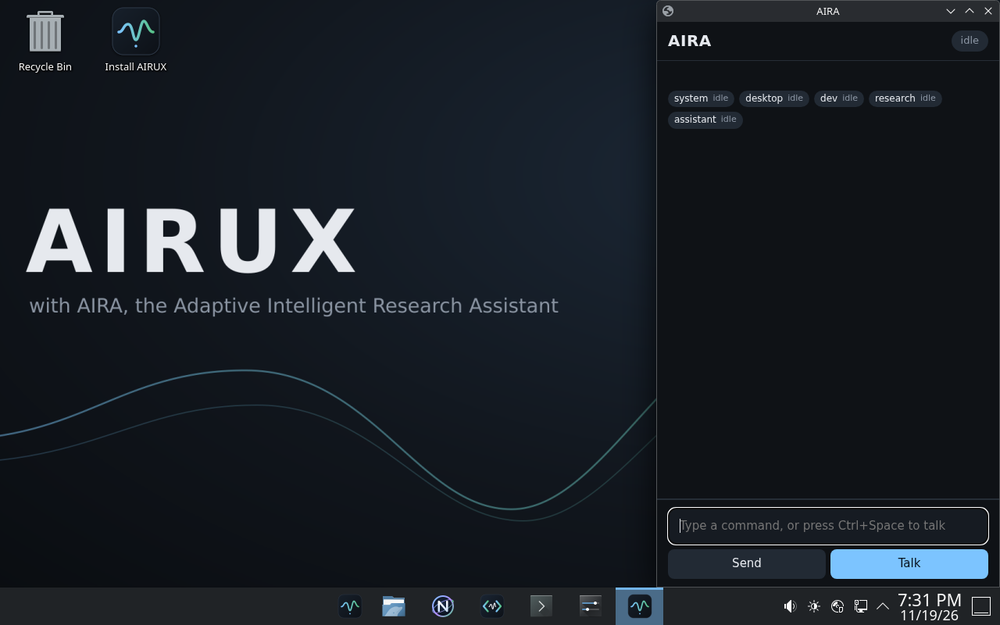
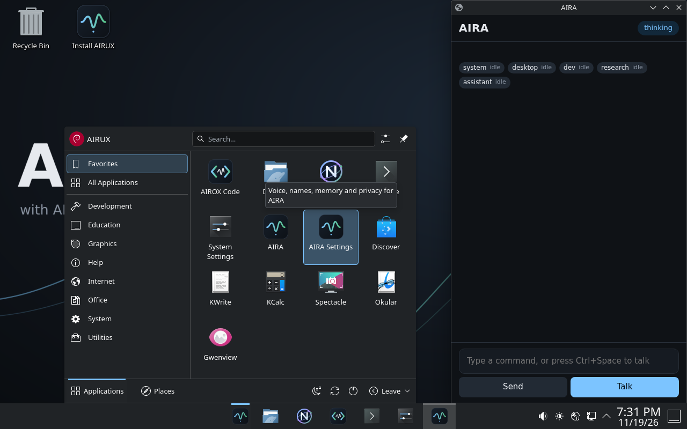
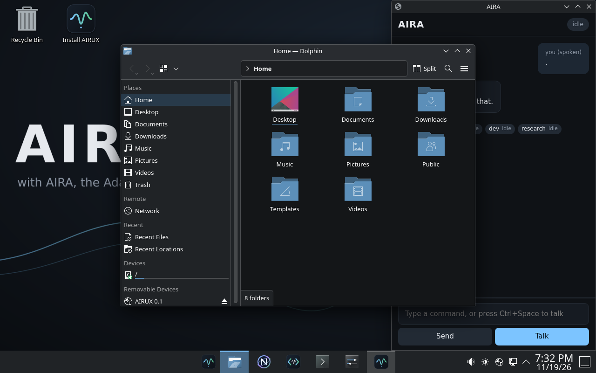
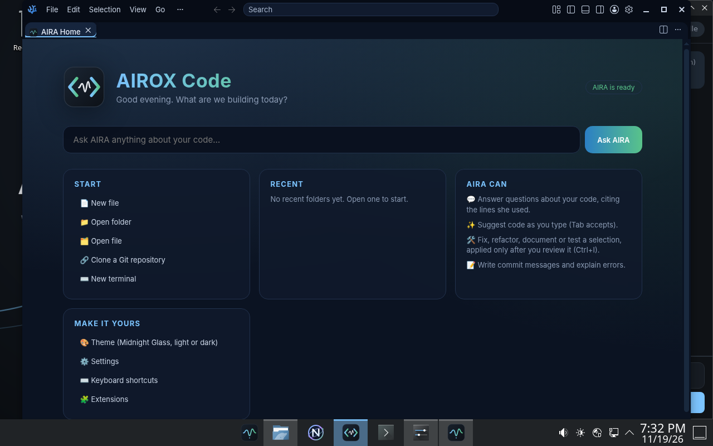
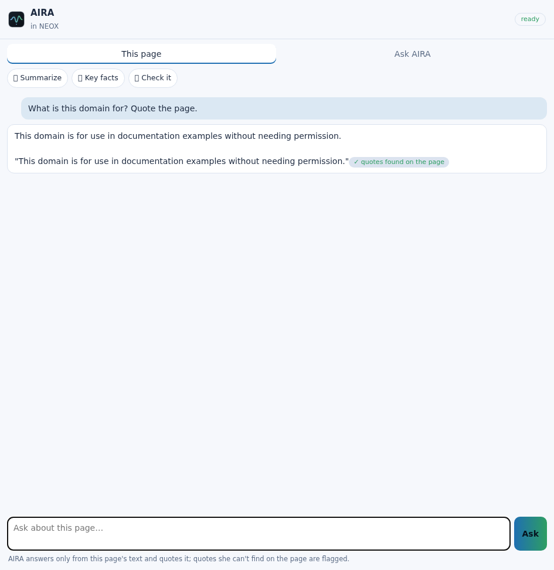
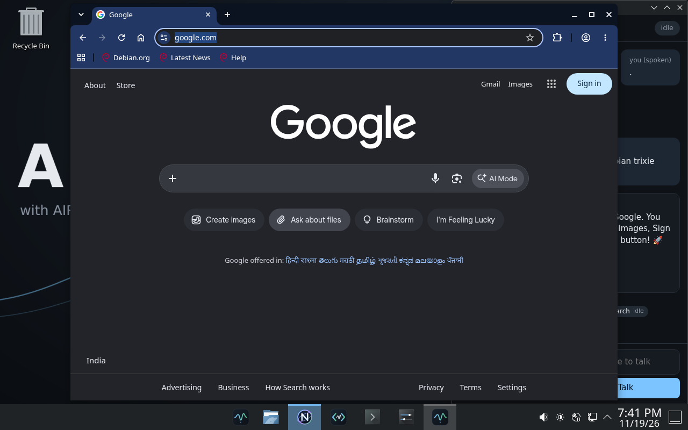
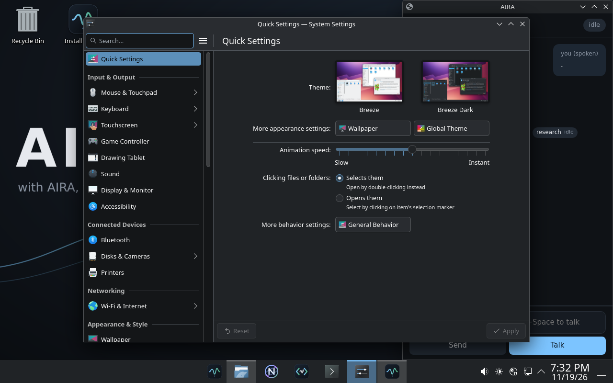
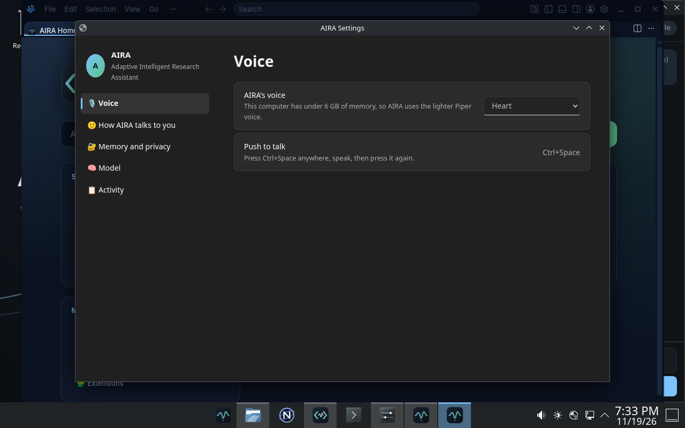
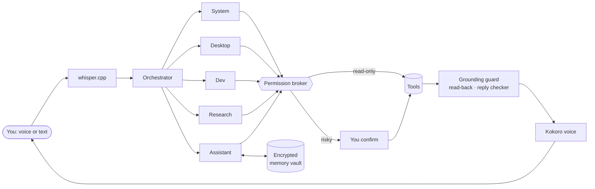

<div align="center">


<h3>A Debian-based operating system with <b>AIRA</b>, a fully local voice assistant that controls your system safely and won't make things up</h3>

[](LICENSE)
[](https://www.debian.org/)
[](https://www.python.org/)
[](https://github.com/ggml-org/llama.cpp)

[](tests/unit)
[](docs/EVAL.md)
[](docs/EVAL.md)
[](docs/ARCHITECTURE.md)

[Features](#-features) ·
[Screenshots](#-screenshots) ·
[Installation](#-installation-guide) ·
[Build from source](#-build-from-source) ·
[Architecture](#-architecture) ·
[Evaluation](#-evaluation) ·
[Roadmap](#-roadmap)

</div>

---

## ✨ What is AIRUX?

**AIRUX** is an operating system for developers, engineers, researchers and scientists. It is
Debian 13 with a developer toolchain, plus **AIRA** (*Adaptive Intelligent Research Assistant*), a
voice assistant built into the desktop.

You talk to AIRA ("How much disk space do I have?", "Run the tests in my project", "Remind me in
ten minutes to stretch") and she does it with real tools on your machine. **Everything runs
locally:** the language model, speech recognition, text-to-speech and her encrypted memory. Nothing
leaves your computer unless you say so.

What makes AIRA different is the **grounding guard**. It is a set of checks written in code, not
prompts:
- She never acts on files, apps or services that don't exist.
- She never claims an action is "done" without checking the result.
- She confirms with you before anything risky.
- She says *"I'm not sure"* instead of guessing.

## 🚀 Features

| | |
| --- | --- |
| 🎙️ **Voice first** | Push-to-talk (Ctrl+Space). [whisper.cpp](https://github.com/ggml-org/whisper.cpp) understands you, and [Kokoro-82M](https://huggingface.co/hexgrad/Kokoro-82M) gives AIRA a natural voice, with a Piper fallback for small machines. |
| 🧠 **One local model, five agents** | A Qwen3.5 GGUF served by `llama-server` powers an orchestrator and five specialists: **System, Desktop, Dev, Research and Assistant**. They run as parallel slots, not as copies of the model. |
| 📏 **Sized to your hardware** | At first boot a profiler measures RAM, VRAM, cores and tokens per second, then picks the model tier (2B, 4B, 9B or 27B) and the number of parallel agents. |
| 🛡️ **Permission broker** | Every tool call goes through it. Deleting, overwriting, installing, root actions, network changes and anything sent off the machine wait for your confirmation. This is enforced in code, and every action is logged. |
| ✅ **Grounding guard** | Nine layers: constrained tool calls, entity checks, facts only from tools, stop on failure, 2-of-3 agreement for risky actions, read-back after acting, a reply checker, citations, and honest abstention. |
| 🔐 **Encrypted memory** | A SQLCipher vault with keyword and vector search, retention rules, decay and a quota. Ask "what do you know about me", "forget X", "export my memory" or "pause memory". |
| ⏰ **Reminders and briefing** | A reminder daemon gives desktop notifications and speaks them aloud. A login briefing covers today's events, due reminders and watched jobs; calendars import from .ics files. |
| 🔬 **Research tools** | Search local notes and papers, summarise PDFs with citations, inspect datasets, run Jupyter notebooks, and search arXiv and the web (with your OK). |
| 🐝 **Worker swarm** | Async workers for file search and fetching, a "pheromone board" that learns which approach works, and a load controller that adds or sheds agents with system pressure. |
| 🪟 **Windows 11-style desktop** | KDE Plasma 6 laid out like Windows 11: a centred taskbar with a Start button, pinned apps and search, a File Explorer (Dolphin), a full Settings app (Wi-Fi, Bluetooth, display, sound, power, apps) and the shortcuts you know (Win, Win+E, Win+I, Win+D, Win+L, Win+arrows). |
| 🖥️ **AIRA side panel** | AIRA docks on the right like Copilot: live transcript, active agents, pending confirmations and verified/unverified tags. Ctrl+Space talks to her from anywhere, and **AIRA Settings** covers voice, names, memory and privacy. |
| 💻 **AIROX Code** | The AIRUX code editor: VSCodium (the open-source build of VS Code) with AIRA built in, like Copilot, and a look of its own (*Midnight Glass*: floating rounded panels, pill tabs, a top activity bar and an **AIRA Home** start page). It offers chat with cited sources, inline suggestions, edits applied only after review, commit messages and error explanations, all on the local model. |
| 🌐 **NEOX browser** | The AIRUX browser, built on Chromium's engine with Brave-style protection: **Shields** (uBlock Origin Lite), strict privacy defaults (HTTPS-only, third-party cookies blocked, no telemetry, DuckDuckGo), **Global Privacy Control**, fingerprinting protection, and a **private window with Tor**. AIRA browses in it: say *"open the browser and search for X"*, or ask about the page you're reading in NEOX's AIRA side panel, where answers must quote the page. |
| 💿 **Real OS image** | A live ISO with AIRUX branding, a Plymouth splash and the Calamares installer. It is tested end to end in QEMU: boot, install, then AIRA answering by voice. |

## 📸 Screenshots

<div align="center">

| Desktop with AIRA docked | Start menu |
| :---: | :---: |
|  |  |
| **File Explorer** | **AIROX Code** |
|  |  |
| **NEOX with AIRA's side panel** | **AIRA searching in NEOX** |
|  |  |
| **Settings** | **AIRA Settings** |
|  |  |
| **Installer finished** | **Installed system** |
|  |  |

</div>

## 💻 System requirements

| | Minimum | Recommended |
| --- | --- | --- |
| CPU | 64-bit x86 (amd64), 4 cores | 6+ cores |
| Memory | 8 GB RAM (2B model) | 16 GB RAM, or a GPU with 6 GB or more (9B model) |
| Disk | 25 GB for an install | 40 GB or more |
| Firmware | UEFI (Secure Boot can stay on) | UEFI |
| Audio | speakers or headphones | plus a microphone for voice |

The model tier is picked automatically from total memory (RAM plus VRAM):

| Total memory | Under 6 GB | 6–8 GB | 8–24 GB | 24 GB of GPU or more |
| --- | --- | --- | --- | --- |
| Model | Qwen3.5 2B | Qwen3.5 4B | Qwen3.5 9B | Qwen3.5 27B |

## 📦 Installation guide

> **A prebuilt ISO is not published yet:** the image (4.4 GB) is larger than GitHub's 2 GB
> limit for release files. Build it with [Build from source](#-build-from-source), then follow
> these steps.

### Step 1: Check the ISO

The build writes `airux-0.1-amd64.hybrid.iso` and a `SHA256SUMS` file. Check that they match.

```bash
sha256sum -c SHA256SUMS            # Linux
```

```powershell
Get-FileHash .\airux-0.1-amd64.hybrid.iso -Algorithm SHA256   # Windows
```

### Step 2: Write it to a USB stick (8 GB or larger; it will be erased)

- **Windows:** use [Rufus](https://rufus.ie). Select the stick and the ISO, click **Start**, and
  choose **DD Image mode** when asked.
- **Windows or macOS:** use [balenaEtcher](https://etcher.balena.io): *Flash from file*, then the
  stick, then *Flash*.
- **Linux:** find the stick with `lsblk`, then run (double-check `/dev/sdX`):

  ```bash
  sudo dd if=airux-0.1-amd64.hybrid.iso of=/dev/sdX bs=4M status=progress conv=fsync
  ```

### Step 3: Boot from the stick

1. Plug the stick in and power on while pressing the boot-menu key:

   | Brand | Key |
   | --- | --- |
   | Acer | F12 |
   | Dell | F12 |
   | HP | F9 |
   | Lenovo | F12 |
   | ASUS | Esc |

   On some laptops (Acer, for example) the boot menu is off by default: enable it in firmware
   setup first (F2).
2. Choose the USB stick (UEFI). The AIRUX menu starts the live system after 5 seconds.
3. The live desktop logs in automatically, and AIRA's shell opens. The model services take about
   1–3 minutes to load; AIRA is ready when her status shows **idle**.

### Step 4: Talk to AIRA

- Press **Ctrl+Space** (or click **Talk**), speak, then press it again. You can also type in the
  box at the bottom.
- Try:
  - *"How much free disk space do I have in my home folder?"*
  - *"Create a file called notes.txt that says hello."*
  - *"Remind me in 2 minutes to stretch."*
- Risky actions appear under **Waiting for you**, and nothing happens until you confirm.

### Step 5: Install to disk (optional)

> ⚠️ **"Erase disk" wipes the whole disk, including any other operating system.** Use a spare
> disk or the *Manual* partitioning option if you want to keep Windows or another OS.

1. Double-click **Install AIRUX** on the desktop.
2. Choose your language, location and keyboard. Then choose the partitioning, and your name, user
   name and password.
3. Click **Install**, wait for *"All done"*, restart and remove the stick.
4. After logging in, AIRA starts full screen. If your hardware can run a bigger model, AIRA offers
   to download it (`aira-models`), asking you first.

The full guide, with troubleshooting (no boot, black screen, no sound, no microphone), is in
**[docs/USB.md](docs/USB.md)**. A five-command demo for new hardware is in
**[docs/DEMO.md](docs/DEMO.md)**.

### Option B: Add AIRA to an existing Debian 13 system

If you already run Debian 13 (trixie), build the two packages ([Build from source](#-build-from-source),
steps 1–5), then:

```bash
sudo apt install ./aira_0.1.0_amd64.deb ./aira-models-base_0.1.0_all.deb
```

This installs AIRA's model services (`aira-llm`, `aira-embed`, `aira-stt`), the reminder daemon,
the login briefing and the AIRA side panel (autostarted at login). Log out and back in, then run
`aira-shell`, or use `aira` in a terminal.

## 🛠️ Build from source

Everything builds on **Debian 13 (trixie)**: a real machine, a VM, or WSL2 on Windows. Large files
go to `$AIRUX_WORK` (default `/srv/airux-work`).

**1. Install the build tools**

```bash
sudo apt install git build-essential cmake python3 python3-venv python3-dev curl \
                 live-build librsvg2-bin
# optional, to test the image in a VM:
sudo apt install qemu-system-x86 qemu-utils ovmf
```

**2. Get the code and a work folder**

```bash
git clone https://github.com/Absurd28/AIRUX_OS.git && cd AIRUX_OS
sudo mkdir -p /srv/airux-work && sudo chown "$USER" /srv/airux-work
```

**3. Build the inference engines** (pinned versions, checked against their commits)

```bash
bash scripts/setup_llama.sh                     # llama.cpp (CUDA if nvcc is installed)
AIRUX_CPU_ONLY=1 bash scripts/setup_llama.sh    # portable CPU build, shipped in the image
bash scripts/setup_whisper.sh                   # whisper.cpp
```

**4. Download and verify the models** (about 11 GB for every tier; each file is checked by SHA-256)

```bash
python3 scripts/fetch_models.py                       # everything in models/MANIFEST.toml
python3 scripts/fetch_models.py --only qwen3.5-2b     # or just what you need
```

**5. Set up Python and run the tests**

```bash
python3 -m venv /srv/airux-work/venv
/srv/airux-work/venv/bin/pip install -r requirements.lock -r requirements-dev.lock
/srv/airux-work/venv/bin/python -m pytest -q tests/unit        # 233 tests
```

**6. Build the packages and the ISO** (as root)

```bash
sudo bash scripts/build_deb.sh      # -> /srv/airux-work/build/deb/*.deb
sudo bash scripts/build_iso.sh      # -> /srv/airux-work/build/iso/airux-0.1-amd64.hybrid.iso
```

**7. Test the image in QEMU (optional)**

```bash
cp tests/phase8_vm.example.toml tests/phase8_vm.toml   # set a password for the test VM
sudo /srv/airux-work/venv/bin/python tests/phase8_check.py live
sudo /srv/airux-work/venv/bin/python tests/demo_vm.py          # the five-command voice demo
```

## 🧭 Architecture



| Layer | Grounding rule (enforced in code) |
| --- | --- |
| 1 | Tool calls are constrained by a JSON-schema grammar |
| 2 | Every file, app, service, contact or event must exist before acting |
| 3 | Facts come only from tool results in the same turn |
| 4 | A failed lookup stops the turn; nothing is filled in |
| 5 | Risky actions are sampled 3 times; 2 must agree, and then you confirm |
| 6 | Nothing is "done" until the new state is read back |
| 7 | Every number, path, name, time and day word in a reply is checked against the tool output |
| 8 | Research answers cite sources; unsupported sentences are flagged |
| 9 | "I'm not sure" counts as a correct answer when evidence is missing |

The full design is in **[docs/ARCHITECTURE.md](docs/ARCHITECTURE.md)**.

## 📊 Evaluation

AIRA was evaluated on **200 new commands**: tool tasks, multi-agent tasks, risky actions, 60 traps
(missing files, unknowable facts, failing tools, ambiguous requests) and small talk. Every
confirmation was denied, so nothing risky could run.

| Metric | Result |
| --- | --- |
| Error rate | **2.5%** (5 / 200), down from 7.5% at the baseline |
| Risky actions run without confirmation | **0** |
| Actions on missing items (60 traps) | **0** |
| Unknowable questions answered with a guess | **0** |
| Voice demo in QEMU (live ISO, 2B model on CPU) | **5 / 5** |

The details are in [docs/EVAL.md](docs/EVAL.md), and the limitations are listed honestly in
[KNOWN_ISSUES.md](KNOWN_ISSUES.md).

## 🗂️ Project structure

```text
aira/            AIRA: orchestrator, agents, grounding guard, permission broker
  tools/         system · desktop · dev · research · assistant tools
  memory/        SQLCipher vault, embeddings, keys
  profiler/      hardware probe, tier and slot planning, server launch
  swarm/         worker pool, pheromone board, quorum, load controller
  shell/         AIRA side panel and AIRA Settings (HTTP + SSE, Chromium)
airox-code/      AIROX Code: the AIRA extension (chat, inline, reviewed edits, AIRA Home), Midnight Glass theme
neox/            NEOX browser: extension (AIRA bridge, side panel, new tab, privacy), launchers, policies
image/           live-build configuration for the AIRUX ISO
packaging/       systemd units, polkit rule, branding, Debian packaging
scripts/         build llama.cpp / whisper.cpp, fetch models, build .deb and ISO, QEMU control
models/          MANIFEST.toml: every model file with its source and SHA-256
tests/           unit tests, milestone checks, 200-command evaluation, VM tests
docs/            architecture, USB guide, demo, evaluation reports
```

## 🗺️ Roadmap

- [x] Local LLM with hardware-based tier and slot selection
- [x] Five agents, permission broker and a 9-layer grounding guard
- [x] Encrypted memory, reminders and login briefing
- [x] Offline voice: whisper.cpp in, Kokoro out
- [x] Worker swarm, research tools, browser control
- [x] Bootable, installable ISO tested in QEMU
- [x] 200-command evaluation
- [x] Windows 11-style Plasma desktop with AIRA docked like Copilot
- [x] AIROX Code: a VS Code-based editor with AIRA built in, with its own Midnight Glass look
- [x] NEOX: a Chromium-based private browser with Shields, Tor windows and AIRA built in
- [ ] Real-hardware validation across more laptops
- [ ] "Hey AIRA" wake word (openWakeWord)
- [ ] Optional NVIDIA driver in the image
- [ ] Legacy BIOS installs
- [ ] Prebuilt ISO downloads

## 🤝 Contributing

Issues and pull requests are welcome. Please run the unit tests before opening a PR:

```bash
/srv/airux-work/venv/bin/python -m pytest -q tests/unit
```

New tools must declare their risks so the permission broker can protect users, and must come with
tests.

## 📄 License

AIRUX's own code is released under the **[MIT License](LICENSE)**. Bundled third-party components
(Debian, llama.cpp, whisper.cpp, Qwen3.5, Kokoro, Piper and others) keep their own licenses, listed
in **[LICENSES.md](LICENSES.md)**.

<div align="center">
<sub>Built by <a href="https://github.com/Absurd28">Aryan Mitra</a> · AIRUX 0.1</sub>
</div>
