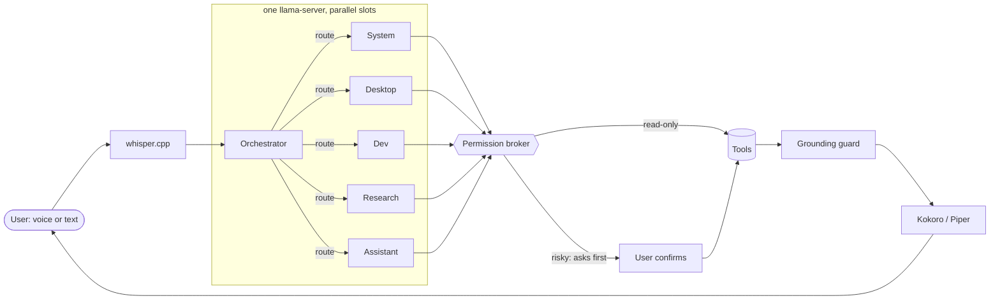

# AIRUX architecture

AIRUX is a Debian 13 based operating system for developers, engineers, researchers and scientists.
Its built-in voice assistant, **AIRA** (Adaptive Intelligent Research Assistant), answers by voice,
controls the system safely, remembers the user, and does not act on things that aren't real.

This document is the design specification that the code follows. Measured results are in
[EVAL.md](EVAL.md), and limitations are in [KNOWN_ISSUES.md](../KNOWN_ISSUES.md).

## The operating system

- **Base:** Debian 13 (trixie) with the stock kernel and drivers. The kernel is not modified.
- **AIRA's place in it:** she runs as privileged systemd services, never as kernel code.
- **One local model serves every agent:** Qwen3.5 GGUF through llama.cpp's `llama-server`, started
  with `--jinja`. Thinking mode is off for tool calls.
- **Model tier by total memory** (RAM plus VRAM), all 4-bit GGUF builds:

  | Total memory | Model |
  | --- | --- |
  | under 6 GB | 2B |
  | 6–8 GB | 4B |
  | 8–24 GB | 9B |
  | 24 GB of GPU or more | 27B |

- **Preinstalled for the target users:** Python 3, Jupyter, git, Podman, build-essential, LaTeX,
  and GPU drivers when the hardware is present.
- **AIRA's own code:** Python 3 with minimal, pinned dependencies (`requirements.lock`).

## Agents



- **Orchestrator:** turns one command into tasks and assigns them to sub-agents. It never answers
  free-text questions itself; it routes them, asks, or says they're unsupported.
- **Five sub-agents** share the same model. Each has its own system prompt and at most 8 tools; the
  Desktop agent has a 9th, the browser.

  | Agent | Covers |
  | --- | --- |
  | System | settings, power, network, services, packages, GPU and disk health |
  | Desktop | files, apps, windows, clipboard, screenshots, the browser |
  | Dev | git, terminals, builds, tests, containers, Python environments, watched jobs |
  | Research | local papers and notes, Jupyter, datasets, web and arXiv search |
  | Assistant | memory vault, calendar, reminders, briefing |

- **Agents are parallel `llama-server` slots,** not extra copies of the model:

  slots = (free memory − model size − 2 GB reserve) ÷ memory per slot

  The result is capped by the number of CPU cores, with a minimum of 1.
- **Worker swarm:** async jobs that need no model (file search, page fetch, scripts). Each worker
  writes a success score for its approach to a SQLite "pheromone board". Scores decay daily, and
  agents try the highest-scoring approach first.
- **Load controller:** every 5 seconds it reads memory pressure (PSI), temperature and latency. It
  adds one slot when the system is healthy and halves the slots when it isn't.
- **Routines:** AIRA can turn a repeated task into a script with a trigger (a time, a file change,
  a finished job). She shows the script, and installs it as a systemd user timer or service only
  after the user approves.

## Permission broker

Every tool call passes through the broker. Read-only actions run freely. These need the user's
confirmation:

- deleting or overwriting anything;
- installing anything;
- network changes;
- sending anything off the machine (search queries included);
- anything that needs root;
- arbitrary commands.

The broker computes the risk in code, not in prompts, and logs every action in the encrypted
memory vault.

## Grounding guard

These hallucination controls are implemented in code, not only in prompts.

| Layer | Rule |
| --- | --- |
| 1 | **Constrained output:** tool calls use a JSON-schema grammar, so only registered tools and valid arguments can be produced. |
| 2 | **Entity check:** every referenced file, app, process, container, contact or event must exist before AIRA acts. If one doesn't, she asks; she never guesses a path. |
| 3 | **Facts only from tools:** questions about the system, files or schedule are answered only from a tool result in the same turn. Topics no tool can see (email, messages, weather, prices, bank) get "I'm not sure" in code. |
| 4 | **A failed lookup means stop:** tool errors are reported plainly, and a missing result is never filled in. |
| 5 | **Agreement:** risky actions are sampled 3 times; AIRA acts only if 2 samples match and the user confirms. |
| 6 | **Read-back:** after acting, AIRA checks the new state before saying "done". |
| 7 | **Reply checker:** every number, path, name, time and day word in a reply is compared with the tool outputs, and the reply is regenerated on a mismatch. |
| 8 | **Citations:** research answers cite local files or URLs. Sentences no source supports are flagged, and answers with no source are labelled "unverified". |
| 9 | **Abstention:** prompts and evaluation treat "I'm not sure" as correct when evidence is missing. |

## Memory vault

- **Storage:** one SQLCipher-encrypted SQLite file, unlocked at login and never synced off the
  machine. The key comes from the desktop keyring when it is unlocked; otherwise from a key file
  only the user can read.
- **Size:** 256 MB quota by default (configurable from 64 MB to 2 GB). A RAM cache under 32 MB holds
  the profile, today's schedule and open tasks.
- **Search:** keyword search (FTS5) plus vector search (sqlite-vec), merged with reciprocal-rank
  fusion. A small embedding model served by llama-server provides the vectors.
- **Retention:**

  | Kind | Kept for |
  | --- | --- |
  | Profile | until the user changes it |
  | Schedule items | until 30 days after the event |
  | Episodes | 90 days, then compacted to one line |
  | Working notes | cleared at midnight |
  | Action log | 30 days |

- **Importance and eviction:** each item has an importance score that decays daily and rises when
  used. A nightly job purges expired items and compacts old episodes. If the vault is over quota,
  it evicts the lowest-scored episodes first. Profile items and future schedule items are never
  evicted automatically.
- **Voice commands:** "what do you know about me", "forget X", "export my memory", "pause memory".
- **Reminder daemon** (a systemd user service): it checks every 30 seconds. At the due time it shows
  a desktop notification and speaks the reminder, and repeats it at unlock if the screen was locked.
- **Login briefing:** today's events, due reminders, and watched jobs that finished or failed.
  Calendars are imported from .ics files.

## Voice

- **Speech in:** whisper.cpp, with a vocabulary prompt for technical words. File names and AIRA's
  name are corrected after recognition.
- **Speech out:** Kokoro-82M in a separate process, voice `af_heart` by default and switchable by
  voice. Under 6 GB of memory it falls back to a Piper female voice.
- **Activation:** push-to-talk (Ctrl+Space or the Talk button). An openWakeWord "Hey AIRA" model is
  planned.
- **Persona:** warm, human and a little funny. AIRA confirms before anything risky, and says "I'm
  not sure" or "I couldn't verify that" instead of guessing.

## Shell and desktop

- **Desktop:** KDE Plasma 6 laid out like Windows 11, set by the AIRUX look-and-feel package.
  - A centred taskbar with a Start button (the AIRA logo), pinned apps, tray, clock and
    show-desktop.
  - Breeze Dark with the AIRUX accent.
  - Dolphin as the file explorer, and System Settings for Wi-Fi, Bluetooth, display, sound, power
    and apps.
  - Windows shortcuts: Win, Win+E, Win+I, Win+D, Win+L, Win+arrows, Win+Shift+S.
- **AIRA side panel:** the AIRA shell is a Chromium app window, docked on the right edge by a KWin
  script, like Copilot. It shows the transcript, the active agents, pending confirmations, and
  verified/unverified tags. Ctrl+Space (a KDE global shortcut) toggles push-to-talk from anywhere.
- **AIRA Settings:** a page of the shell with voice, names, memory (pause, quota, export),
  model and an activity log. Every change is read back before it is reported as saved.
- **AIROX Code:** VSCodium rebranded, with the AIRA extension built in:
  - chat whose `[file:line]` citations are checked against the code AIRA read;
  - fill-in-the-middle inline suggestions;
  - Fix / Refactor / Document / Tests, shown as a diff and applied only after Accept, then read
    back;
  - commit messages, and explanations of terminal errors and problems.

  It talks only to the model on this computer. Its look is AIROX's own ("Midnight Glass": a theme
  plus a stylesheet appended to the workbench, with product.json's checksums updated), and it opens
  on **AIRA Home** instead of VS Code's Welcome page.
- **NEOX browser:** Debian's Chromium started with NEOX's own profile, two extensions and managed
  policies (HTTPS-only, third-party cookies blocked, no telemetry or Safe Browsing lookups,
  DuckDuckGo):
  - **Shields:** uBlock Origin Lite (Manifest V3).
  - **NEOX extension:** new tab page, Global Privacy Control, canvas and audio farbling, AIRA's
    side panel, and the bridge to AIRA.
  - **Private window with Tor:** `neox-private` starts `tor.service` on demand (polkit) and opens a
    throwaway profile through its SOCKS proxy.
- **Browser control:** in the desktop session AIRA browses in NEOX:

  ```text
  AIRA's agents -> NeoxBridge (Unix socket, 0600) -> native host org.airux.neox -> NEOX extension -> tab
  ```

  Each command (open, search, read, click, back) returns what the page now shows, for read-back.
  Questions in NEOX's side panel go the other way and are answered only from the page's text; every
  quote is checked against the page, and answers that quote nothing are tagged unverified. Outside
  the desktop (tests, no NEOX), AIRA falls back to Chromium driven through Playwright.

## Phagos (antivirus)

Phagos (from phagocyte) is AIRUX's own antivirus. It is standard-library Python, packaged as
`phagos`; `phagosd` runs as root.

```text
fanotify (close-write, open-exec-perm) ─► scanner ─► clean / suspicious / malicious ─► allow, deny, quarantine
/proc every 2 s + write events ─► signals ─► Dendritic Cell Algorithm ─► pause (SIGSTOP), the user decides
/run/phagos/phagos.sock ◄─ phagos CLI, phagos-agent (notifications + Phagos Security app), AIRA's `security` tool
```

- **Features:** each file becomes a 12-number vector (entropy, size, ELF traits, packer marks,
  printable share, suspicious strings, network strings, location, exec bit).
- **Signatures:** in-house TOML rules (text, hex, regex; conditions; magic; path globs) and a
  SHA-256 blocklist; no third-party database.
- **Negative Selection:** real-valued V-detectors generated outside the "self" of the image's own
  package programs (learned at image build). A file inside a detector is foreign; alone that is
  only noted, with heuristics it is suspicious.
- **Clonal Selection:** a confirmed threat clones and mutates the nearest detectors; the best
  clone that still avoids self becomes a memory detector named after the threat, so variants are
  recognised.
- **Dendritic Cell Algorithm:** per process, PAMP (decoy written, signature hit, deleted or temp
  executable), danger (mass random-looking rewrites, write bursts, new connections) and safe
  (package-owned, steady) signals; anomalous MCAV pauses the process. Writes are charged to the
  responsible process, past package tools (openssl, cp) to the script driving them.
- **Response (like Defender):** malicious → blocked and quarantined; suspicious → blocked from
  running or reported, the user decides; dangerous behaviour → paused until kill, quarantine or
  allow. Turning protection off, restoring and allowing need an administrator (polkit).

## Image

- **Packages:**
  - `aira.deb` holds the app, a pinned virtual environment, CPU builds of llama.cpp and whisper.cpp,
    the systemd units, a polkit rule and the autostart entries.
  - `aira-models-base.deb` holds the 2B model, embeddings, whisper and Kokoro.
- **First boot:** a profiler measures the hardware and recommends the right model tier, which
  `aira-models` downloads after asking.
- **ISO:** a live-build image with AIRUX branding, KDE Plasma, the Calamares installer, Plymouth,
  the developer toolchain and AIROX Code.

## Build milestones

| # | Milestone | Check |
| --- | --- | --- |
| 0 | Setup: llama.cpp, models | `llama-server` answers a test prompt |
| 1 | Hardware profiler | Right tier here and under a simulated memory cap |
| 2 | AIRA core: orchestrator, agents, ~30 tools, broker | 16 of 20 commands give the right tool call; no destructive tool runs unconfirmed |
| 3 | Grounding guard | 50 traps: zero actions on missing items, zero "done" without read-back |
| 4 | Memory vault and reminders | Reminder fires by voice and notification; expiry, compaction and quota work |
| 5 | Voice | Ten spoken commands work with the network off |
| 6 | Swarm and research tools | Faster with workers; a planted false sentence is flagged |
| 7 | Shell and browser | "Open the browser and search for X" works by voice |
| 8 | Package and image | The ISO boots in QEMU, installs to disk, and AIRA answers by voice |
| 9 | Hardware and evaluation | Five demo commands on real hardware; error rate recorded |
